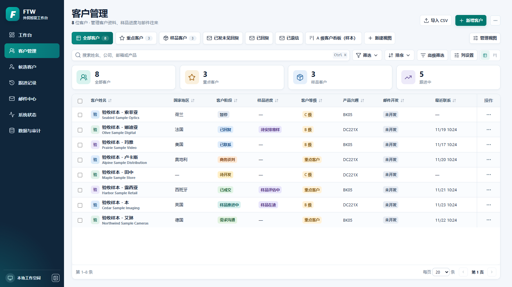

# FTW 外贸智能工作台

FTW 是一款运行在 Windows 上的本地外贸工作台，用于管理客户、跟进沟通和邮件开发。你可以自己在桌面操作，也可以让 WorkBuddy、Codex 等支持 MCP 的 Agent 协助处理同一份业务资料。



*客户管理界面，图中使用示例数据。*

## 主要功能

- **客户管理**：记录联系人、公司、联系方式、客户阶段、产品兴趣、样品进度、调查资料和自定义字段；支持视图、筛选、查重和跟进记录。
- **邮件工作**：配置 SMTP 和 IMAP，管理邮件草稿、模板、发送记录、客户回复及邮件与客户的关联。
- **Agent 协作**：通过本地 MCP 连接 WorkBuddy、Codex 等客户端，查询和维护客户资料、整理跟进记录、创建草稿，并按工作台中设置的权限发信。
- **数据管理**：提供 CSV 导入导出、客户文件、备份恢复、操作审计和诊断报告。

## 开始使用

### 运行工作台

系统需要 Windows 10 或 Windows 11 x64，以及 Microsoft Edge WebView2 运行时。

将便携 ZIP 完整解压到可写目录，双击 `workbench.exe`。请保留同一目录下的 `ftw-core.exe`、`ftw-mcp.exe` 和 `portable.flag`。工作台的数据保存在便携目录的 `data` 文件夹，首次使用会自动创建。

### 配置邮箱

1. 在「邮件中心 → 发件账户」添加邮箱，填写邮箱服务商提供的 SMTP 地址、端口和登录信息，保存后测试连接。
2. 在「邮件中心 → 收件设置」配置 IMAP 并测试连接，以同步和查看客户回复。
3. 根据邮箱服务商的要求使用邮箱授权码或应用专用密码。只使用客户管理时可以暂不配置邮箱。

邮件由 FTW 记录发送结果：SMTP 已接受表示服务器接受了提交，不等于已经投递到收件箱；发送结果未知时，应先核对记录再决定是否重试。

### 连接 WorkBuddy

1. 在 FTW「邮件中心 → Agent 发信权限 → Agent 登记」中登记 WorkBuddy，并保存本次显示的令牌。
2. 在 WorkBuddy 的「专家·技能·连接器 → 连接器 → 自定义连接器」中打开 MCP 管理，添加或修改 `ftw`：传输方式选择本地 `stdio`，命令指向便携目录中的 `ftw-mcp.exe`，参数留空。
3. 将登记令牌通过 MCP 启动环境中的 `FTW_AGENT_TOKEN` 提供给进程。不要将令牌粘贴到聊天或明文配置中。具体配置方法及常见问题见[接入说明](docs/FTW-Agent-Quickstart.txt)。
4. 在 WorkBuddy 中新建本地任务，让它调用 FTW 查询客户。需要自动发信时，再由用户在 FTW 中选择允许的邮箱、用途和限额并保存授权；也可以使用逐封审批模式。

便携包内还附有 `FTW-Agent-Workflows.txt`，提供可复制的客户调查、跟进及邮件任务示例。其他支持 MCP stdio 的客户端也可使用同一份工作台，具体接入方式见[接入说明](docs/FTW-Agent-Quickstart.txt)。

## 备份与故障排查

- 在「数据与审计」中创建和恢复备份。迁移便携工作台前，关闭 FTW 和 MCP 客户端，并完整复制工作台目录及其数据和备份。
- 更换 Windows 用户或电脑后，需要重新输入并测试 SMTP、IMAP 凭据，并将 MCP 客户端的命令路径改为新位置。
- 遇到问题时，在「系统状态」导出诊断报告；如果窗口无法打开，可双击便携目录中的 `FTW-Diagnostics.cmd`。分享报告前请先检查内容，再附上出错时间和操作步骤。

## 从源码运行和构建

开发环境需要 Windows PowerShell 5.1、Node.js 24 或更高版本、npm、Rust x64 MSVC 工具链、Visual Studio C++ x64 Build Tools、Windows SDK 和 WebView2。

在项目根目录运行开发版：

```powershell
powershell.exe -NoProfile -ExecutionPolicy RemoteSigned -File .\scripts\dev.ps1
```

构建 Windows x64 便携版：

```powershell
powershell.exe -NoProfile -ExecutionPolicy RemoteSigned -File .\scripts\build-portable.ps1
```

构建完成后，便携目录和 ZIP 位于 `.ftw-dev\packages`；终端会显示 ZIP 路径和 SHA-256 校验值。

## 更多文档

- [WorkBuddy 与 Codex 接入说明](docs/FTW-Agent-Quickstart.txt)
- [Agent 外贸任务示例](docs/FTW-Agent-Workflows.txt)
- [邮件与 MCP 工具说明](docs/MCP_MAIL.md)
- [CRM 接口说明](docs/CRM_API.md)
- [数据存储与系统架构](docs/ARCHITECTURE.md)
