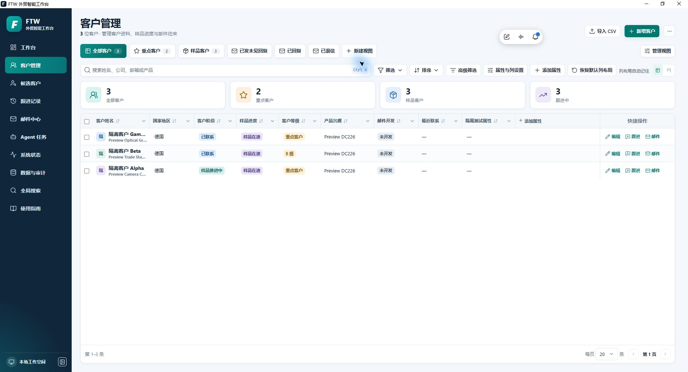

# FTW 外贸智能工作台

FTW 是一款运行在 Windows 上的本地外贸工作台，用于管理客户、跟进沟通和邮件开发。你可以自己在桌面操作，也可以让 WorkBuddy、Codex 等支持 MCP 的 Agent 协助处理同一份业务资料。

当前源码版本为 **1.1.10**，支持 Windows 10／11 x64。已发布的便携版可在 [GitHub Releases](https://github.com/zengbbxx11/FTW/releases) 下载；当前实现和验证范围见[项目状态](docs/PROJECT_STATUS.md)。



*客户管理界面，图中使用隔离的示例数据。*

## 主要功能

- **客户管理**：记录联系人、公司、联系方式、客户阶段、产品兴趣、样品进度、调查资料和自定义字段；支持视图、筛选、查重和跟进记录。
- **邮件工作**：配置 SMTP 和 IMAP，管理邮件草稿、模板、发送记录、客户回复及邮件与客户的关联。
- **Agent 协作**：通过本地 MCP 连接 WorkBuddy、Codex 等客户端，查询和维护客户资料、整理跟进记录、创建草稿，并按工作台中设置的权限发信。
- **数据管理**：提供 CSV 导入导出、客户文件、备份恢复、操作审计和诊断报告。

## 开始使用

### 运行工作台

系统需要 Windows 10 或 Windows 11 x64，以及 Microsoft Edge WebView2 运行时。

从 [GitHub Releases](https://github.com/zengbbxx11/FTW/releases) 下载 Windows x64 便携 ZIP，完整解压到可写目录，双击 `workbench.exe`。请保留同一目录下的 `ftw-core.exe`、`ftw-mcp.exe` 和 `portable.flag`。工作台的数据保存在便携目录的 `data` 文件夹，首次使用会自动创建。

工作台侧边栏的「使用指南」包含邮箱、客户、Agent 接入和备份的简明步骤。

### 配置邮箱

1. 在「邮件中心 → 发件账户」添加邮箱，填写邮箱服务商提供的 SMTP 地址、端口和登录信息，保存后测试连接。
2. 在「邮件中心 → 收件设置」配置 IMAP 并测试连接，以同步和查看客户回复。
3. 根据邮箱服务商的要求使用邮箱授权码或应用专用密码。只使用客户管理时可以暂不配置邮箱。

FTW 运行时默认每 10 分钟同步已配置的收件邮箱，可在收件箱调整频率或关闭。关闭工作台后不会为自动同步常驻后台。

收件箱保留全部来信，有客户线索且尚未确认归属的邮件进入「客户来信待核对」。普通未知来信不强制提醒；无关邮件可以标记为非客户邮件，并随时恢复。没有客户档案时，可从发件人新建客户后关联。

客户管理的统计卡片可以直接筛选客户。表格支持拖动列宽、添加属性和每视图自动记住列布局，每行可直接编辑、添加跟进或查看邮件。新建视图时可设置筛选、排序和列布局，保存前查看匹配数量；自建视图可以删除，删除视图不会删除客户。

邮件由 FTW 记录发送结果：SMTP 已接受表示服务器接受了提交，不等于已经投递到收件箱；发送结果未知时，应先核对记录再决定是否重试。

### 连接 WorkBuddy

1. 在 FTW「使用指南」复制为当前目录生成的 WorkBuddy 配置，在 WorkBuddy 的「连接器 → 自定义连接器」中粘贴。已有其他连接器时，使用单独的 `ftw` 配置片段并保留其他内容。
2. 正常启动 WorkBuddy，在本地任务中让它调用 FTW 查询客户。无需登记 Agent 或提供令牌。
3. 需要自动发信时，在 FTW「邮件中心 → Agent 发信权限」选择“本机 Agent”、允许的邮箱、用途和限额并保存授权；也可以使用逐封审批模式。

同一 Windows 用户下的本地 MCP 客户端共享“本机 Agent”身份和其发信权限，可以在工作台暂停或恢复本机接入。具体配置说明见[接入说明](docs/FTW-Agent-Quickstart.txt)。

便携包内还附有 `FTW-Agent-Workflows.txt`，提供可复制的客户调查、跟进及邮件任务示例。其他支持 MCP stdio 的客户端也可使用同一份工作台，具体接入方式见[接入说明](docs/FTW-Agent-Quickstart.txt)。

### 更新 FTW

在「系统状态 → 软件更新」检查正式版本，选择「立即更新」。程序会保留原目录中的客户、邮件和邮箱配置；WorkBuddy 的连接器路径不变。更新前请完成当前任务并关闭 WorkBuddy 和其他 FTW 连接器。

如果旧版还没有更新入口，先打开旧版 FTW，再运行新版便携包里的 `FTW-Update.exe`，按提示完成首次升级。旧版后台 Core 空闲退出可能需要几分钟。升级失败时先不要删除原工作台，在「系统状态」导出诊断报告。

## 备份与故障排查

- 在「数据与审计」中创建和恢复备份。迁移便携工作台前，关闭 FTW 和 MCP 客户端，并完整复制工作台目录及其数据和备份。
- 更换 Windows 用户或电脑后，需要重新输入并测试 SMTP、IMAP 凭据，并将 MCP 客户端的命令路径改为新位置。
- 遇到问题时，在「系统状态」导出诊断报告；如果窗口无法打开，可双击便携目录中的 `FTW-Diagnostics.cmd`。分享报告前请先检查内容，再附上出错时间和操作步骤。

## 从源码运行和构建

开发环境需要 Windows PowerShell 5.1、Node.js 24 或更高版本、npm、Rust x64 MSVC 工具链、Visual Studio C++ x64 Build Tools、Windows SDK 和 WebView2。

在项目根目录运行开发版：

```powershell
powershell.exe -NoProfile -ExecutionPolicy RemoteSigned -File .\scripts\dev.ps1
```

构建 Windows x64 便携版：

```powershell
powershell.exe -NoProfile -ExecutionPolicy RemoteSigned -File .\scripts\build-portable.ps1
```

普通构建保存在 `.ftw-dev\builds`，不会混入正式发行目录。正式发行使用 `-ForRelease`，每个版本只生成一套 `.ftw-dev\packages\v版本号` 发行文件；已存在的发行版本不能覆盖。ZIP 内固定为 `FTW-Portable` 文件夹，日常更新继续使用原工作台位置。详见[发行说明](docs/RELEASING.md)。

本地日常体验包统一使用项目内的 `.ftw-dev\packages\FTW-LastTest`，后续构建在此原位置更新并保留数据。其他设备使用相同的项目相对路径，也可通过不提交到 Git 的本机配置指定位置。详见[跨设备开发与固定体验目录](docs/RELEASING.md#跨设备开发与固定体验目录)。

## 更多文档

- [WorkBuddy 与 Codex 接入说明](docs/FTW-Agent-Quickstart.txt)
- [Agent 外贸任务示例](docs/FTW-Agent-Workflows.txt)
- [邮件与 MCP 工具说明](docs/MCP_MAIL.md)
- [CRM 接口说明](docs/CRM_API.md)
- [数据存储与系统架构](docs/ARCHITECTURE.md)
- [当前实现与验证范围](docs/PROJECT_STATUS.md)
- [便携版发行与更新维护](docs/RELEASING.md)
